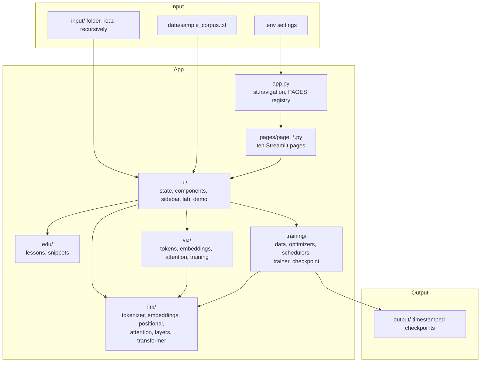
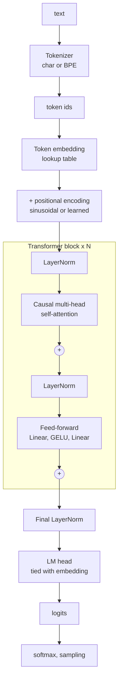
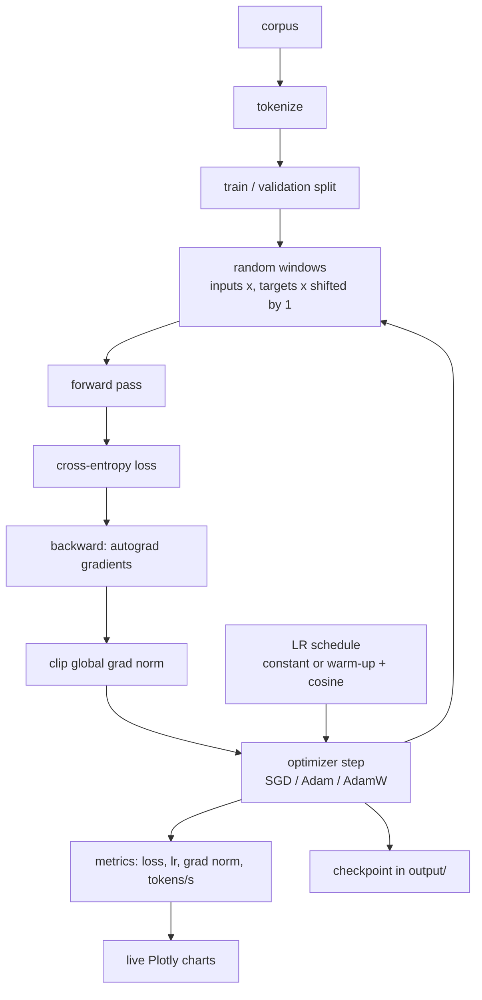
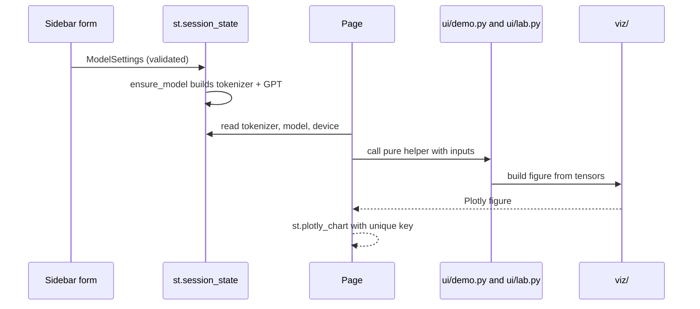
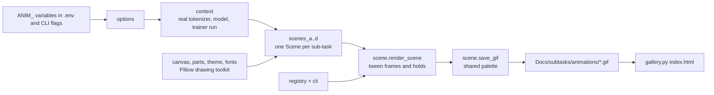

# Architecture

## Layers

Dependency rule: arrows only point downwards. `llm/`, `training/` and `viz/`
never import Streamlit, so they can be tested and read on their own.

## The model (`llm/`)

Pre-norm residual blocks are used because they train stably without a long
warm-up. Attention is computed as `softmax(Q K^T / sqrt(d_k) + causal mask) V`
per head, then the heads are concatenated and projected.

## Training loop (`training/`)

## UI data flow

## Animations (`animgen/`)

A `Scene` is a caption per step plus one `draw(canvas, ctx, step, t)` function.
The `Context` computes everything lazily from the project's own code, so a GIF
that needs the trained model trains it once and the others stay fast. Like
`llm/` and `training/`, the package never imports Streamlit.

## Design decisions

- **Hand-written components**: `nn.MultiheadAttention`, `nn.TransformerEncoder`
  and `nn.LayerNorm` are used only inside tests as numerical references.
- **Streamlit-free helpers**: page logic lives in `ui/demo.py` and
  `ui/lab.py`, so it is covered by plain unit tests.
- **One test module per source module**, plus `AppTest` runs of every page.
- **Configuration only through `.env`**: host, port, device, seed and folders.
- **Checkpoints** store model config, weights, optimizer state and history;
  the sinusoidal table is a non-persistent buffer and is rebuilt on load.
