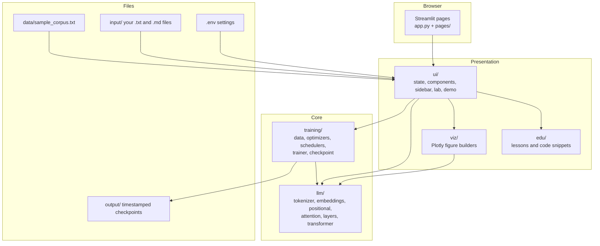
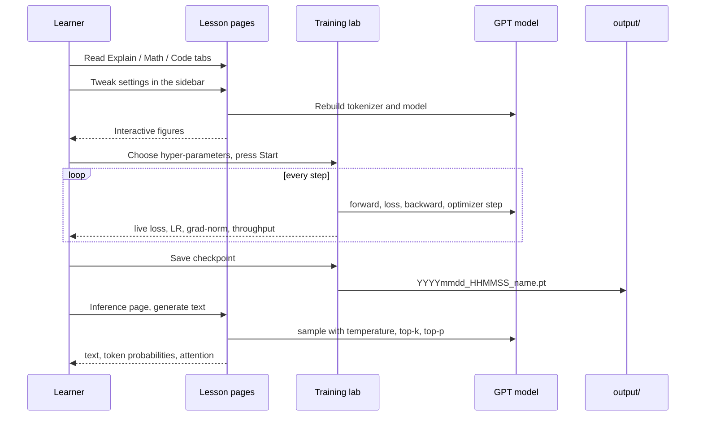

# LLM From Scratch Lab

An interactive, fully local teaching app that shows how a GPT-style
decoder-only language model is built, trained and used. Every core component
is written by hand in plain PyTorch (tensors and autograd only), so you can
read the code, change hyper-parameters in the browser and watch the effect.

- **Nine lesson pages**: tokenization (character and BPE), embeddings,
  positional encoding, attention, multi-head attention, LayerNorm and the
  feed-forward network, the full transformer, a training lab and inference.
- **Three views per lesson**: a plain-language explanation, the maths
  (formulas with intuition) and the real source code of this project.
- **Live visualizations** built with Plotly: token boundaries, embedding maps,
  attention heat-maps, positional waves, loss, learning-rate, gradient-norm and
  throughput curves that update while the model trains.
- **Hand-written training stack**: SGD with momentum, Adam and AdamW, warm-up
  plus cosine learning-rate schedules, gradient clipping, checkpoints.
- **No cloud, no external services**: everything runs on your machine (CPU,
  or Apple GPU through MPS when available).

## Architecture



Layers only depend downwards: `pages/` call `ui/`, `ui/` calls `edu/`, `viz/`,
`training/` and `llm/`. The model code in `llm/` and `training/` never imports
Streamlit, which keeps it easy to test and to read.

## Workflow



## Quick start

```bash
cp .env.example .env        # optional, defaults work without it
uv venv .venv && uv pip install -r requirements.txt --python .venv/bin/python
scripts/start.sh            # prints http://localhost:8601
scripts/stop.sh             # graceful shutdown
```

More detail: [Docs/Quickstart.md](Docs/Quickstart.md) and
[Docs/Architecture.md](Docs/Architecture.md).

## Documentation of the ten sub-tasks

Every sub-task has a scientific explanation (Markdown and standalone HTML) and
an implementation guide (standalone HTML), all in `Docs/subtasks/`. Open
[Docs/subtasks/index.html](Docs/subtasks/index.html) in a browser (no server,
no network needed). Rebuild after editing a source with:

```bash
scripts/build-docs.sh            # all pages; add --only 6 for one sub-task
```

The generator is the `docsgen/` package (Markdown, latex2mathml and Pygments).
Every number in the pages is read from the running code or the recorded
reference run, and every page is validated during the build.

## Project layout

| Folder | Purpose |
|---|---|
| `llm/` | Hand-written model: tokenizer, embeddings, positional encoding, attention, layers, GPT |
| `training/` | Data windows, SGD/Adam/AdamW, LR schedules, trainer loop, checkpoints |
| `viz/` | Plotly figure builders (pure functions, no Streamlit) |
| `edu/` | Lesson text, formulas and the code snippets shown in the app |
| `ui/` | Session state, reusable components, sidebar form, lab and demo helpers |
| `pages/` | One file per lesson page (`page_<name>.py`) |
| `data/` | Bundled demo corpus |
| `input/`, `output/` | Optional extra training text; timestamped results |
| `scripts/` | `start.sh`, `stop.sh`, `cleanup.sh`, `build-docs.sh` |
| `docsgen/` | Generator that builds the HTML documentation from Markdown |
| `Docs/subtasks/` | Explanations and implementation guides for the ten sub-tasks |
| `tests/` | pytest suite, one test module per source module |

## Tests

```bash
bash .bob/skills/test-gate/scripts/run_tests.sh .
```

The suite checks the maths against references (for example the hand-written
LayerNorm and attention against PyTorch's), gradient flow, the optimizers
against known update rules, and every Streamlit page through `AppTest`.

## Data and attribution

`data/sample_corpus.txt` is original text written for this project (a short
story about a robot and a clockmaker). It carries no third-party license and
is released under the same license as the code. Put your own `.txt` or `.md`
files in `input/` (read recursively) to train on them as well.

## License

MIT. Copyright (c) the LLM From Scratch Lab contributors. You may use, copy,
modify and distribute this project under the terms of the MIT License.
