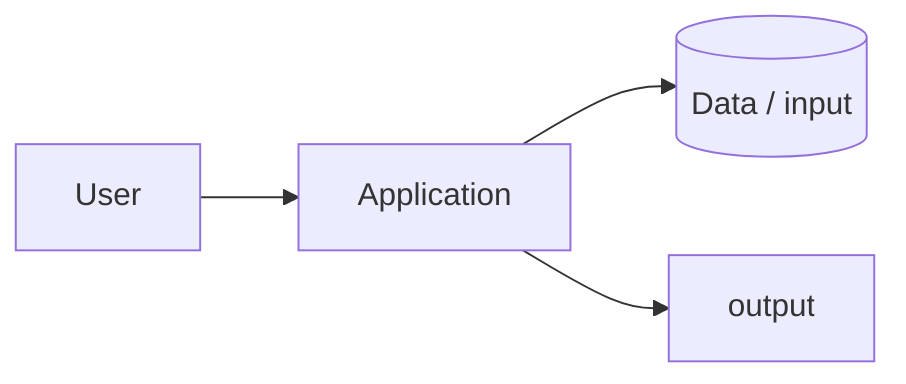
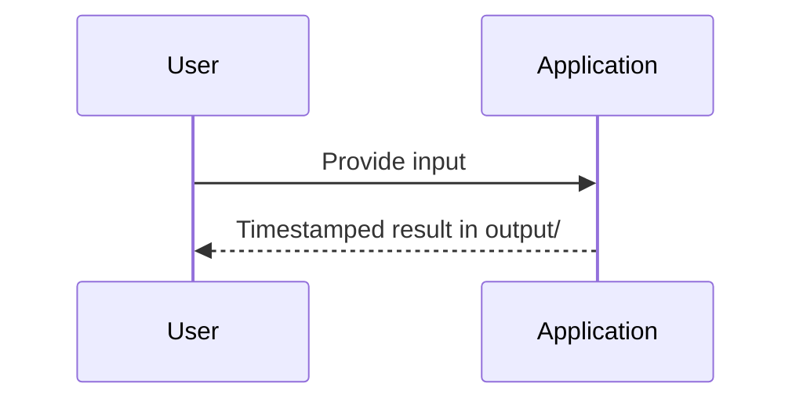

# LLM From Scratch Lab

One-paragraph description of what the project does.

## Architecture

## Workflow

## Quick start

See [Docs/Quickstart.md](Docs/Quickstart.md) and [Docs/Architecture.md](Docs/Architecture.md).

## License

MIT
